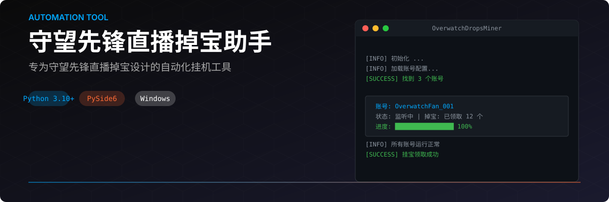
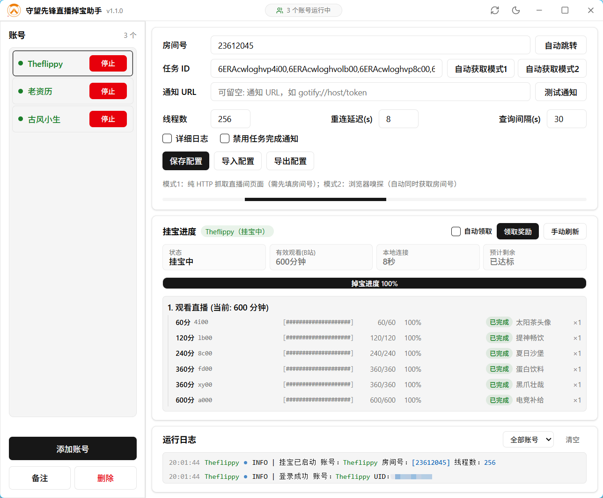
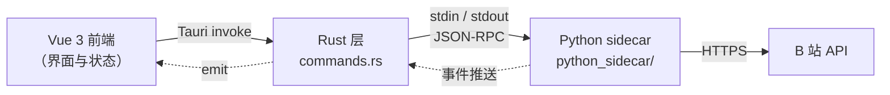

<p align="center">
  
</p>
<p align="center">
  <a href="LICENSE"></a>
  <a href="https://tauri.app"></a>
  <a href="https://vuejs.org"></a>
  <a href="https://www.python.org/downloads/"></a>
  
</p>
<p align="center">
  <b>多账号挂机 · 自动领取掉宝奖励 · 实时进度追踪</b><br>
  <sub>基于 <a href="https://github.com/mi0e/BiliBiliDropsMiner">BiliBiliDropsMiner</a> 二次改造，界面已重构为 Tauri 2 + Vue 3</sub>
</p>

---

## 界面预览

<p align="center">
  
</p>

---

## 核心功能

| 功能 | 说明 |
| :--- | :--- |
| **多账号挂机** | 同时管理多个 B 站账号，每账号独立 Cookie、独立任务进度 |
| **扫码登录** | 内置二维码登录，无需手动抓包 Cookie |
| **浏览器自动捕获** | 一键从 Edge / Chrome 自动读取登录态 |
| **自动领取奖励** | 掉宝任务完成后自动领取，支持 Gotify / 企业微信 / Server酱 等多渠道通知 |
| **实时进度追踪** | 以 B 站服务器计时为准，断线自动暂停、重连续累 |
| **深浅色主题** | 首次启动跟随系统，支持一键切换 |
| **分账号日志** | 多线程日志按账号分流，界面实时显示 |
| **凭据加密** | Cookie 经 Windows DPAPI 加密后落盘，明文不落磁盘 |
| **配置隔离** | 设置 `OW_CONFIG_DIR` 即可把全部持久化重定向到指定目录 |

> [!NOTE]
> 界面没有托盘，窗口关闭即退出程序；有账号正在挂宝时会先弹窗阻止，避免误关。

---

## 快速开始

### 方式一：下载发布版（推荐）

前往 [Releases](https://github.com/Theflippy978/OverwatchDropsMiner/releases) 下载
`OverwatchDropsMiner-win-v1.1.0.zip`（约 48 MB），**解压即用、免安装**。

压缩包内含两个文件，**必须放在同一目录**（解压后默认就在一起，请勿只复制其中一个）：

| 文件 | 大小 | 作用 |
| :--- | ---: | :--- |
| `overwatch-drops-miner.exe` | 10.2 MB | 主程序，双击启动 |
| `python_sidecar.exe` | 44.7 MB | Python 后端，由主程序自动拉起 |

> [!IMPORTANT]
> 只复制主程序会因找不到 `python_sidecar.exe` 而无法启动。
> 两者是配套的，**不要分开移动或单独重命名**。

<details>
<summary><b>校验下载完整性</b></summary>

```powershell
Get-FileHash .\OverwatchDropsMiner-win-v1.1.0.zip -Algorithm SHA256
# 应为 41350D6A72B10343859FD76631CBE5D0FE0424266E33FDD90D744BAFB125AD85
```

</details>

### 方式二：从源码运行

<details>
<summary><b>展开：源码运行与打包步骤</b></summary>

**环境要求**：Windows 10/11 · Node.js 22+ · pnpm · Python 3.14 · Rust 工具链（含 MSVC）

```powershell
git clone https://github.com/Theflippy978/OverwatchDropsMiner.git
cd OverwatchDropsMiner

pnpm install
pnpm tauri dev          # 开发模式
```

打包发布版：

```powershell
# 改过 python_sidecar/ 后必须用它重打 sidecar，否则程序仍跑旧 Python 代码
pwsh -NoProfile -File tests/build-release.ps1

# 把两个产物压成发布包
Compress-Archive `
  -Path src-tauri/target/release/overwatch-drops-miner.exe,
        src-tauri/target/release/python_sidecar.exe `
  -DestinationPath dist/OverwatchDropsMiner-win-v1.1.0.zip -Force
```

> [!WARNING]
> 裸 `pnpm tauri build` **不会**重新打包 Python，只编译 Rust 并复制已有的
> `src-tauri/binaries/*.exe`。改过 `python_sidecar/` 却只跑它会得到
> 「构建成功、行为未变」的产物。

</details>

---

## 使用指南

### 第一步：录入账号（三选一）

- [ ] **扫码登录** —— 点击「添加账号 → 扫码登录」，用哔哩哔哩手机客户端扫码
- [ ] **手动粘贴** —— 从浏览器复制 Cookie 后粘贴
- [ ] **浏览器自动捕获** —— 点击「浏览器自动捕获」，从 Edge / Chrome 读取登录态

### 第二步：配置挂机

| 配置项 | 默认值 | 说明 |
| :--- | :--- | :--- |
| 房间号 | `23612045` | 支持多个，用逗号分隔；可用「自动跳转」捕获 |
| 任务 ID | 空 | 可留空由浏览器嗅探自动获取 |
| 线程数 | `60` | 单账号连接数，**上限 256** |
| 重连延迟 | `8` 秒 | 断线后重连间隔 |
| 查询间隔 | `30` 秒 | 向 B 站查询任务进度的周期 |

### 第三步：启动

选择账号 → 点击「启动」。任务进度、B 站有效观看时长与掉宝进度会实时刷新。

---

## 通知渠道

通知地址填在「通知 URL」一栏，支持多个（逗号或换行分隔）：

| 渠道 | URL 格式 |
| :--- | :--- |
| Gotify | `gotify://host/token` |
| Server酱 | `schan://sendkey` |
| 企业微信群机器人 | `wecombot://key` |
| 企业微信应用 | `wxwork://corpid/corpsecret/agentid` |
| 其他 | 任意 [Apprise](https://github.com/caronc/apprise) 支持的 URL |

---

## 工作原理



<details>
<summary><b>展开：IPC 与进程管理细节</b></summary>

- **通信链路**：前端 ←(invoke)→ Rust ←(stdin/stdout JSON-RPC)→ Python sidecar。
  请求/响应信封键为 `rid`，与业务字段 `id`（账号 id）严格分离。
- **日志通道**：`stdout` 只承载 JSON 协议，日志统一走 `stderr`，避免污染协议。
- **进程回收**：Rust 侧创建 `KILL_ON_JOB_CLOSE` 的 Job Object 并在 spawn 后挂接
  sidecar —— 主进程被任务管理器强杀或崩溃时，内核会自动回收 sidecar，
  不会留下孤儿进程。

</details>

---

## 目录结构

```text
OverwatchDropsMiner/
├── src/                          # Vue 3 前端
│   ├── components/               # 业务组件（账号列表 / 配置卡 / 日志 / 进度）
│   ├── components/ui/            # shadcn-vue 基础组件
│   ├── stores/                   # Pinia 状态管理
│   └── App.vue                   # 根组件（主题 / 窗口几何 / 生命周期）
├── src-tauri/                    # Rust 层
│   └── src/
│       ├── lib.rs                # Builder 配置 + 命令注册
│       ├── main.rs               # 入口
│       └── commands.rs           # 命令实现 + SidecarManager（进程 / IPC）
├── python_sidecar/               # Python sidecar（全部业务代码）
│   ├── main.py                   # IPC 主循环与命令分发
│   └── backend/                  # 挂宝 / 账号 / 浏览器嗅探 / B 站客户端
├── img/                          # README 素材（hero.svg / run.png / app.ico）
└── tests/                        # 本地门禁与测试（不入库，仅本机运行）
```

---

## 技术栈

| 层 | 技术 |
| :--- | :--- |
| 桌面壳 | [Tauri 2](https://tauri.app)（Rust） |
| 前端 | [Vue 3](https://vuejs.org) + TypeScript + Vite + [Tailwind CSS v4](https://tailwindcss.com) |
| UI 组件 | [shadcn-vue](https://www.shadcn-vue.com)（底层 reka-ui） |
| 状态管理 | [Pinia](https://pinia.vuejs.org) |
| 后端 | Python 3.14 sidecar（stdin/stdout JSON-RPC） |
| 打包 | PyInstaller（sidecar）+ Tauri（主程序） |

---

## 配置与数据位置

| 内容 | 位置 |
| :--- | :--- |
| 账号库（DPAPI 加密） | `%APPDATA%\OverwatchDropsMiner\accounts.json` |
| 应用配置 | `%APPDATA%\OverwatchDropsMiner\config.json` |
| 隔离模式 | 设置环境变量 `OW_CONFIG_DIR=<目录>`，上述文件全部重定向到该目录 |

---

## 常见问题

<details>
<summary><b>点了「启动」没反应 / 提示 Cookie 已失效</b></summary>

Cookie 可能已过期。重新用「扫码登录」或「浏览器自动捕获」录入账号即可。

</details>

<details>
<summary><b>找不到浏览器 / 自动捕获失败</b></summary>

「自动获取模式2」依赖本机的 Edge 或 Chrome。若都没装、或被安全软件拦截，
可以改用**不需要浏览器**的方式：

**先试「自动获取模式1」** —— 它是纯 HTTP 抓取直播间页面，完全不启动浏览器。
前提是**先填好房间号**（任务 ID 就挂在直播间页面上）。若房间没有正在进行的
掉宝活动，它会返回「未解析到掉宝任务分组」，这不是故障。

**模式1 也不可用时，手动填写任务 ID：**

1. 浏览器打开 `https://live.bilibili.com/<房间号>`，进入正在做掉宝活动的直播间；
2. 按 `F12` 打开开发者工具 → **网络 / Network** 面板；
3. 刷新页面，在筛选框里搜 `task_ids`；
4. 在请求的 URL 里找到 `task_ids=` 后面的值，形如
   `6ERAcwloghvp4i00,6ERAcwloghvolb00` —— 这就是任务 ID；
5. 复制这段值（**含逗号一起复制**）粘贴到「任务 ID」输入框。

也可以直接粘贴整条带参数的 URL —— 程序会自动从 `task_ids=` 后面截取，
无需手动裁剪。

**想彻底不用浏览器**：填好房间号 + 任务 ID 后，关闭「自动获取」相关操作直接启动即可 ——
挂宝本身不依赖浏览器，只有「自动捕获 Cookie / 房间号 / 任务 ID」这些辅助功能才需要。

</details>

<details>
<summary><b>日志出现乱码</b></summary>

确保以 UTF-8 运行；程序内部已强制 `PYTHONIOENCODING=utf-8`，正常启动不应出现。
若仍乱码，请附上日志提交 Issue。

</details>

<details>
<summary><b>程序启动即闪退</b></summary>

先确认 `python_sidecar.exe` 与主程序在同一目录（见上方 IMPORTANT 提示）。
若目录正确仍闪退，可能是安全软件拦截了 WebView2 创建 —— 将程序目录加入信任列表后重试。

</details>

<details>
<summary><b>怎么升级到新版本</b></summary>

下载新的 zip，解压后**覆盖旧目录里的两个 exe** 即可。或者点击程序右上角的更新按钮，
按提示前往下载页面。

配置与账号不会丢 —— 它们存在 `%APPDATA%\OverwatchDropsMiner\`，与程序目录无关。

</details>

---

## 版本信息

| 项 | 值 |
| :--- | :--- |
| 当前版本 | **v1.1.0** |
| 发布包 | `OverwatchDropsMiner-win-v1.1.0.zip`（47.5 MB） |
| 包内文件 | `overwatch-drops-miner.exe` + `python_sidecar.exe` |
| 平台 | Windows 10 / 11（x64） |
| 主程序 SHA256 | `D252B67FE5D4095FF208E77BC3AE24D6AB1F636B4E1E582686A4B0A50267BBE0` |
| 侧车 SHA256 | `7C94F91CAAD6BD9495470F7D1C5181F71C3F55DA024852E17655B48891BD5D72` |
| 发布包 SHA256 | `41350D6A72B10343859FD76631CBE5D0FE0424266E33FDD90D744BAFB125AD85` |

---

## 免责声明

> [!CAUTION]
> - 本工具**仅供个人学习研究使用**，请勿用于商业用途或大规模刷取。
> - 使用即代表你同意遵守 [B 站用户协议](https://www.bilibili.com/protocal/licence.html) 及相关法律法规。
> - 作者**不对**因使用本工具导致的账号封禁、数据丢失等后果负责。
> - 请合理控制挂机时长与线程数，避免给服务器造成不必要的压力。
> - 本项目与哔哩哔哩、暴雪娱乐均无任何关联。

---

## 许可证

本项目采用 **GNU General Public License v3.0** 开源协议，详见 [LICENSE](LICENSE)。

---

## 致谢

- [mi0e/BiliBiliDropsMiner](https://github.com/mi0e/BiliBiliDropsMiner) —— 提供了完整的 B 站掉宝自动化基础架构
- [Tauri](https://tauri.app) · [Vue](https://vuejs.org) · [shadcn-vue](https://www.shadcn-vue.com) · [Apprise](https://github.com/caronc/apprise)

<p align="center">
  <sub>如果这个项目对你有帮助，欢迎点一个 ⭐ Star</sub>
</p>
